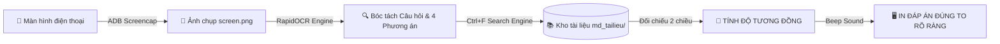

# Thanh_Nien_Viet_Nam_QuizSolver
Trợ lý tự động nhận diện và giải đề thi trắc nghiệm Thanh Niên Việt Nam qua màn hình điện thoại 
<div align="center">
### 🇻🇳 Trợ Lý Tra Cứu Đáp Án Thi Trắc Nghiệm Thanh Niên Việt Nam (Realtime OCR)

[](https://www.python.org/)
[](#)
[](#)
[](#)
[](#)
[](#)

<p align="center">
  <b>Tự động chụp màn hình điện thoại qua ADB ➔ Nhận diện chữ siêu tốc bằng OCR ➔ Tra cứu Ctrl+F trực tiếp trong kho tài liệu Markdown ➔ Hiển thị đáp án đúng tức thì kèm âm thanh báo hiệu!</b>
</p>

[✨ Tính năng nổi bật](#-tính-năng-nổi-bật) •
[📁 Cấu trúc dự án](#-cấu-trúc-dự-án) •
[⚙️ Cài đặt nhanh](#️-cài-đặt-nhanh) •
[📱 Hướng dẫn bật USB Debugging](#-hướng-dẫn-bật-usb-debugging) •
[🚀 Cách dùng](#-hướng-dẫn-sử-dụng) •
[📖 Thêm tài liệu mới](#-thêm-tài-liệu-mới)

---

</div>

## 🎯 QUY TRÌNH HOẠT ĐỘNG (WORKFLOW)



---

## ✨ TÍNH NĂNG NỔI BẬT

- ⚡ **Siêu tốc (< 0.5s):** Xử lý và hiển thị ngay đáp án ngay khi bạn vừa đổi câu.
- 🎯 **Độ chính xác tuyệt đối:** Sử dụng cơ chế so khớp kép — so sánh ngữ nghĩa câu hỏi kết hợp đối chiếu chéo đáp án với 4 lựa chọn thực tế trên màn hình.
- 📊 **Hiển thị độ tương đồng chi tiết:** Báo cáo độ tin cậy theo % (ví dụ: `Độ tương đồng: 100% (Khớp câu hỏi 96% + Trùng khớp phương án)`).
- 🔔 **Báo hiệu âm thanh (Beep):** Phát tiếng chuông thông báo mỗi khi phát hiện và giải xong câu hỏi mới.
- 📂 **Kho tài liệu mở rộng (`md_tailieu/`):** Chỉ cần ném file `.md` bất kỳ vào thư mục, hệ thống sẽ tự nạp tự động 100%.
- 🛡️ **Tự phục hồi kết nối ADB:** Không bị văng ứng dụng nếu lỡ tuột dây cáp, tự động kết nối lại ngay khi cắm lại.
- ⚠️ **Nhận diện câu hỏi mới:** Nếu gặp câu chưa có trong tài liệu, hệ thống cảnh báo rõ ràng và in sẵn các phương án trên màn hình để bạn tự tin lựa chọn.

---

## 📁 CẤU TRÚC DỰ ÁN

```text
📦 TNVN-Quiz-Solver/
├── 📄 CHAY_TRO_LY.bat          # 🚀 1-Click để khởi chạy trợ lý ngay lập tức
├── 📄 CAI_DAT.bat              # 🛠️ 1-Click để cài đặt toàn bộ thư viện cần thiết
├── 📄 requirements.txt         # 📋 Danh sách thư viện Python
├── 📄 README.md                # 📖 Hướng dẫn sử dụng và cài đặt chi tiết
│
├── 📂 md_tailieu/              # 📚 THƯ MỤC CHỨA TÀI LIỆU ÔN THI (.md)
│   ├── 📑 Cán bộ Đoàn.md
│   ├── 📑 NQ ĐH XIV Đảng.md
│   ├── 📑 NQ ĐH Đoàn XIII.md
│   └── 📑 ĐVTN.md
│   └── ➕ (Thêm các file .md bất kỳ vào đây)
│
└── 📂 src/                     # 🧠 MÃ NGUỒN HỆ THỐNG
    ├── 🐍 config.py            # Cấu hình đường dẫn & UTF-8 Console
    ├── 🐍 database.py          # Bóc tách & quản lý ngân hàng câu hỏi
    ├── 🐍 ocr_engine.py        # Chụp màn hình qua ADB & Nhận diện chữ OCR
    ├── 🐍 search_engine.py     # Thuật toán Ctrl+F & Tính độ tương đồng
    └── 🐍 main.py              # Giao diện Console & Vòng lặp Realtime
```

---

## ⚙️ CÀI ĐẶT NHANH TRONG 3 BƯỚC

### 1️⃣ Cài đặt Python (Nếu máy chưa có)
> [!IMPORTANT]
> Tải Python tại [python.org](https://www.python.org/downloads/).  
> **BẮT BUỘC:** Trong lúc cài đặt, nhớ tích chọn vào ô: **`☑ Add python.exe to PATH`**!

### 2️⃣ Cài đặt ADB (Android Debug Bridge)
1. Tải bộ công cụ chính thức: 👉 [SDK Platform Tools cho Windows](https://dl.google.com/android/repository/platform-tools-latest-windows.zip).
2. Giải nén vào thư mục, ví dụ: `C:\platform-tools`.
3. Thêm `C:\platform-tools` vào biến môi trường **PATH** của Windows:
   - Bấm phím `Windows` -> Gõ `env` -> Chọn **Edit the system environment variables**.
   - Bấm **Environment Variables** -> Chọn dòng **Path** -> Bấm **Edit** -> Bấm **New** -> Dán `C:\platform-tools` -> Bấm **OK**.

### 3️⃣ Cài đặt thư viện Python
Chỉ cần nhấp đúp chuột vào file:
👉 **`CAI_DAT.bat`** *(Hệ thống sẽ tự động cài `rapidocr-onnxruntime`, `pillow`, ...)*

---

## 📱 HƯỚNG DẪN BẬT "GỠ LỖI USB" TRÊN ĐIỆN THOẠI

Để máy tính chụp được màn hình câu hỏi, bạn cần kích hoạt **Gỡ lỗi USB (USB Debugging)**:

```text
[Cài đặt] ➔ [Giới thiệu điện thoại] ➔ [Nhấn 7 lần vào Số bản dựng / Phiên bản OS] ➔ [Tùy chọn nhà phát triển] ➔ [Bật Gỡ lỗi USB]
```

<details>
<summary><b>🔍 Xem hướng dẫn chi tiết theo từng hãng điện thoại (Bấm để mở)</b></summary>

* **Xiaomi / Redmi / POCO (MIUI / HyperOS):**
  1. Vào `Cài đặt` -> `Giới thiệu điện thoại` -> Nhấn liên tục **7 lần** vào dòng **Phiên bản MIUI / HyperOS** cho đến khi hiện *"Bạn đã là nhà phát triển"*.
  2. Vào `Cài đặt` -> `Cài đặt bổ sung` -> `Tùy chọn nhà phát triển`.
  3. Bật **Gỡ lỗi USB** *(USB Debugging)*. *(Nên bật thêm cả "Cài đặt qua USB" nếu có)*.

* **Samsung (One UI):**
  1. Vào `Cài đặt` -> `Thông tin điện thoại` -> `Thông tin phần mềm`.
  2. Nhấn liên tục **7 lần** vào **Số hiệu bản tạo** *(Build number)*.
  3. Quay lại `Cài đặt` -> Kéo xuống cuối vào `Cài đặt cho người phát triển` -> Bật **Gỡ lỗi USB**.

* **OPPO / Realme (ColorOS / Realme UI):**
  1. Vào `Cài đặt` -> `Giới thiệu thiết bị` -> `Phiên bản`.
  2. Nhấn liên tục **7 lần** vào **Số bản dựng**.
  3. Vào `Cài đặt` -> `Cài đặt hệ thống` -> `Tùy chọn cho nhà phát triển` -> Bật **Gỡ lỗi USB**.

* **Vivo / iQOO (Funtouch OS):**
  1. Vào `Cài đặt` -> `Giới thiệu điện thoại` -> `Thông tin phần mềm`.
  2. Nhấn **7 lần** vào **Số phiên bản phần mềm**.
  3. Vào `Cài đặt` -> `Hệ thống` -> `Tùy chọn cho nhà phát triển` -> Bật **Gỡ lỗi USB**.

</details>

> [!TIP]
> **Khi cắm cáp USB vào máy tính:**  
> Màn hình điện thoại sẽ hiện bảng hỏi: **"Cho phép gỡ lỗi USB?" (Allow USB debugging?)**  
> ➔ Hãy tích chọn: ☑ **"Luôn cho phép từ máy tính này"** ➔ Nhấn **OK**.

---

## 🚀 HƯỚNG DẪN SỬ DỤNG

1. **Cắm cáp nối điện thoại với máy tính** (màn hình điện thoại luôn sáng).
2. **Mở App Thanh Niên Việt Nam** trên điện thoại và vào bài thi trắc nghiệm.
3. **Chạy Trợ Lý:** Nhấp đúp chuột vào file:
   👉 **`CHAY_TRO_LY.bat`**
4. **Chọn kho đề thi:**
   - Nhập **`0`** rồi ấn `Enter`: Quét trong **TẤT CẢ** các tài liệu có trong thư mục `md_tailieu/` *(Khuyên dùng)*.
   - Hoặc gõ số tương ứng để chọn 1 chuyên đề cụ thể.
5. **Làm bài thi & Xem đáp án hiển thị:**

```text
====================================================================
[CÂU 43] | Nguồn: [NQ ĐH Đoàn XIII.md]
📊 ĐỘ TƯƠNG ĐỒNG: 100%  (Câu hỏi khớp 96% + Trùng khớp phương án trên màn hình)
====================================================================

NỘI DUNG CÂU HỎI NHẬN DIỆN ĐƯỢC:
  Theo Điều lệ Đoàn, hình thức kỷ luật nào sau đây áp dụng đối với đoàn viên khi vi phạm?

********************************************************************
>>> ĐÁP ÁN ĐÚNG CẦN CHỌN:

    👉👉👉  Khiển trách, cảnh cáo, khai trừ  👈👈👈

********************************************************************
(Khi bạn chọn xong và ấn 'Tiếp tục', màn hình sẽ tự động đổi câu mới)
```

> [!NOTE]
> Khi bạn bấm chọn đáp án trên điện thoại và sang câu tiếp theo, trợ lý sẽ **phát tiếng bíp** và **lập tức cập nhật câu mới** hoàn toàn tự động!

---

## 📖 THÊM TÀI LIỆU MỚI VÀO `md_tailieu/`

Bạn có thể thêm không giới hạn tài liệu trắc nghiệm mới. Chỉ cần tạo một file `.md` và bỏ vào thư mục `md_tailieu/` theo định dạng chuẩn:

```markdown
Câu hỏi 1. [Nội dung câu hỏi ở đây]
A. [Nội dung phương án A]
B. [Nội dung phương án B]
C. [Nội dung phương án C]
D. [Nội dung phương án D]
Đáp án: A

Câu hỏi 2. [Nội dung câu hỏi tiếp theo]
A. [Phương án A]
B. [Phương án B]
C. [Phương án C]
D. [Phương án D]
Đáp án: C
```

---

## 🛠️ XỬ LÝ SỰ CỐ NHANH

| Sự cố | Nguyên nhân | Cách khắc phục |
| :--- | :--- | :--- |
| 🔴 **Báo chưa tìm thấy thiết bị ADB** | Chưa bật USB Debugging hoặc lỏng dây | Cắm lại cáp, mở khóa màn hình điện thoại, chọn **"Luôn cho phép"** khi có popup hỏi. |
| 🟡 **Tool không cập nhật khi đổi câu** | Điện thoại bị tắt màn hình hoặc bị đơ | Giữ màn hình điện thoại luôn sáng khi làm bài thi. |
| 🟢 **Lỗi font chữ tiếng Việt trên CMD** | Font Windows Console cũ | Luôn chạy bằng file `CHAY_TRO_LY.bat` (đã kích hoạt UTF-8 chuẩn). |

---

<div align="center">

**⭐ Nếu bạn thấy công cụ này hữu ích, hãy để lại 1 Star cho dự án nhé! ⭐**

*Phát triển vì mục tiêu học tập và nâng cao kiến thức cộng đồng.*

</div>
